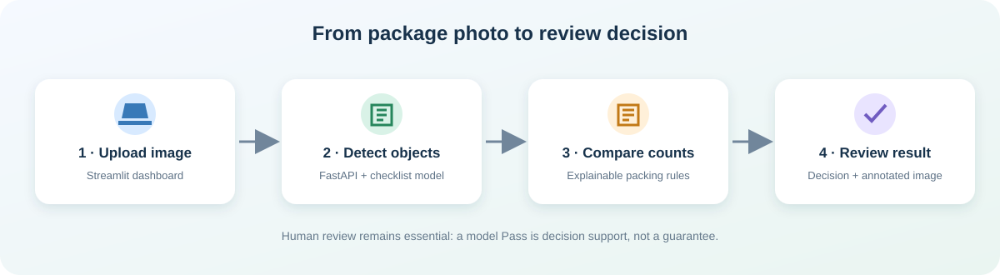
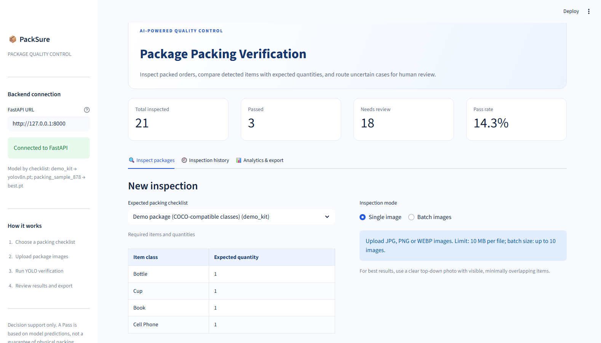
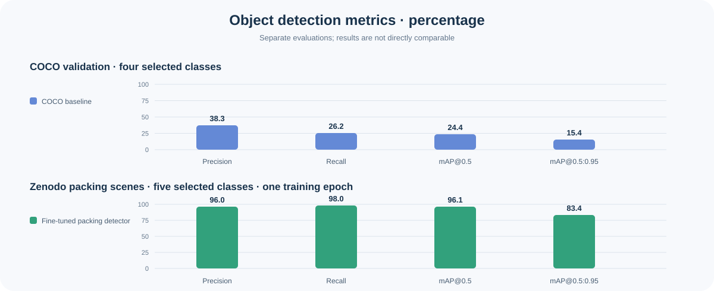

# PackSure — Package Packing Verification

PackSure is a local decision-support prototype for checking visible objects against a packing checklist. It combines YOLO object detection, a FastAPI service, count-based verification rules, SQLite inspection history, and a Streamlit dashboard.

> **A Pass is not proof that a physical package is correct.** Missed, occluded, or misclassified objects can produce incorrect decisions. Keep a human in the review loop.



## Live dashboard screenshot



Captured from the running local app. The counters reflect this workspace's inspection history; they are not model-accuracy measurements.

## At a glance

- **Backend:** FastAPI, Ultralytics YOLO, SQLite
- **Frontend:** Streamlit dashboard for single or batch inspections, history, analytics, and CSV export
- **Checklists:** `demo_kit` uses COCO classes; `packing_sample_878` uses a five-class packing-scene model when its checkpoint is available
- **Input:** JPG, PNG, or WEBP; up to 10 MB per image and 10 images per batch
- **Status:** local academic prototype; package-level accuracy has not been established

## How an inspection works

1. Choose a checklist and upload one or more package images.
2. FastAPI selects the detector configured for that checklist and returns object labels, confidence, and boxes.
3. Verification rules compare confident detections with expected quantities.
4. The dashboard shows Pass or Needs Review, reasons, and annotated images. The API also stores original images and inspection history locally.

## Project visuals



The two panels use different datasets and class sets; compare results only within each evaluation. Neither panel measures package-level accuracy.

## Evaluation status

| Evaluation | Precision | Recall | mAP@0.5 | mAP@0.5:0.95 | What it measures |
|---|---:|---:|---:|---:|---|
| COCO validation, four selected classes | 38.3% | 26.2% | 24.4% | 15.4% | Generic object detection baseline |
| Zenodo packing scenes, five selected classes | 96.0% | 98.0% | 96.1% | 83.4% | Object detection after one training epoch |

The packing-scene figures are exploratory: the held-out split informed development and is not an untouched final benchmark. A live check of sample 878 returned the expected counts, but this sample was also used during development. The source dataset has bounding boxes, not verified package pass/fail outcomes. **Package accuracy, false-pass rate, and false-flag rate remain unmeasured.** See [the COCO report](evaluation/results/coco_baseline.md) and [the packing-scene report](evaluation/results/packingdata_pilot.md) for details and limitations.

The requirement-by-requirement status is in [the proposal compliance review](evaluation/results/proposal_compliance.md). A package-evaluation script is available for when original images and manual labels are recovered: fill each `actual_*` cell with a manually checked count (including `0`), enter `none` or the unexpected class names, set `package_correct_actual` to `true`/`false`, and identify the human verifier. Do not copy YOLO predictions into ground truth. First run `python tools/evaluate_packages.py --preflight`, then export inspections from `/inspections/export.csv` to `evaluation/results/inspection_results.csv` and run `python tools/evaluate_packages.py`. It refuses to calculate results while ground truth or matching predictions are missing or inconsistent.

## Run locally

Use Python 3.11. From the repository root, create an environment and install dependencies:

```powershell
py -3.11 -m venv .venv
.\.venv\Scripts\Activate.ps1
python -m pip install --upgrade pip
pip install -r requirements.txt
pip install -r requirements-frontend.txt
Copy-Item .env.example .env
```

Start the API in one terminal:

```powershell
uvicorn backend.main:app --host 127.0.0.1 --port 8000
```

Start the dashboard in another terminal:

```powershell
python -m streamlit run frontend/app.py --server.address 127.0.0.1 --server.port 8501
```

Open [the dashboard](http://127.0.0.1:8501) or [the API docs](http://127.0.0.1:8000/docs). The sidebar reports the model selected for each checklist. The COCO model weights download automatically on first use if needed.

### Try the packing-scene checklist

The repository excludes the source dataset, generated image copies, and model checkpoints. When the five-class checkpoint is installed at `runs/detect/evaluation/packingdata_yolo_5class/full_train_1ep/weights/best.pt`, the API uses it for `packing_sample_878`. If it is missing, the health response reports the checklist model as unavailable and inspections return a clear error instead of silently using an incompatible detector. To reproduce this experiment, obtain the [Zenodo packingdata dataset](https://doi.org/10.5281/zenodo.7904630), prepare the five-class YOLO layout described in [the dataset notes](evaluation/packingdata_yolo_5class/README.md), and train a compatible checkpoint. The original Zenodo record does not state a license in its rights metadata, so check the terms before redistributing its images or annotations.

In a workspace where you have separately downloaded and prepared the dataset, sample 878 is at `evaluation/packingdata_yolo_5class/images/test/878_mult5-view-2.mkv_20210118_234712.926.jpg`. Upload it with checklist `packing_sample_878`; the annotated counts should be can ×1, cup ×2, apple ×1, bowl ×1. The image and checkpoint are deliberately excluded from Git, so they are not available in a clean clone. This is a functionality check, not independent accuracy evidence.

## Decision rules

- Detections at or above the configured confidence threshold count toward the checklist.
- Missing, unexpected, or excess objects result in **Needs Review**.
- Low-confidence detections and high box overlap also trigger review.
- Thresholds are configurable in `.env`; they require calibration on manually labeled package images before operational use.

## Tests

Run the test suite from the repository root:

```powershell
python -m pytest -q
```

The API tests use a fake detector and do not require model weights. The current suite has 20 passing tests.

## Data, artifacts, and privacy

Git ignores local environment files, model weights, SQLite databases, downloaded datasets, image copies, caches, and training runs. Keep those artifacts out of public commits. The evaluation reports, dataset instructions, and small diagrams are safe to track. Uploaded images and history remain local under `data/`.

This project uses Ultralytics YOLO. Review the [Ultralytics license](https://www.ultralytics.com/license) before redistributing or using the project beyond academic and personal work. The external packing dataset is not included in this repository.

## Known limitations

- Detection scores do not establish package correctness; no held-out, manually verified package pass/fail set is available yet.
- Overlap is only a rough uncertainty signal. Fully hidden items cannot be detected from a single image.
- CPU inference may be slow. SQLite and local image storage suit a single-user demo, not a public production service.
- The prototype has no authentication. Keep the API bound to localhost unless you add appropriate security.
